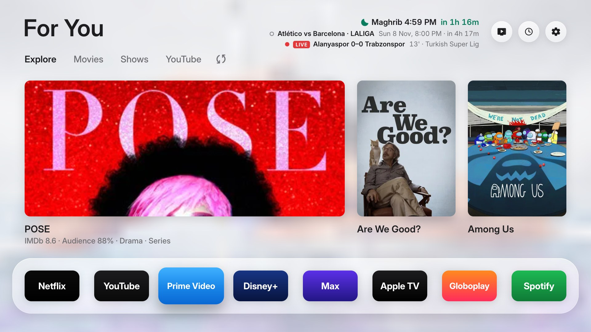
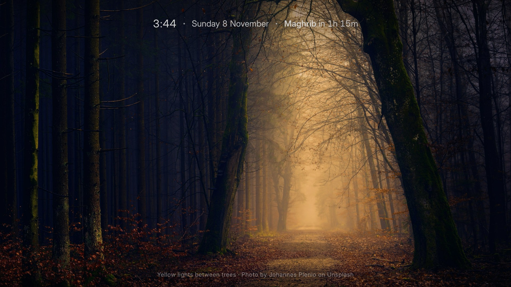
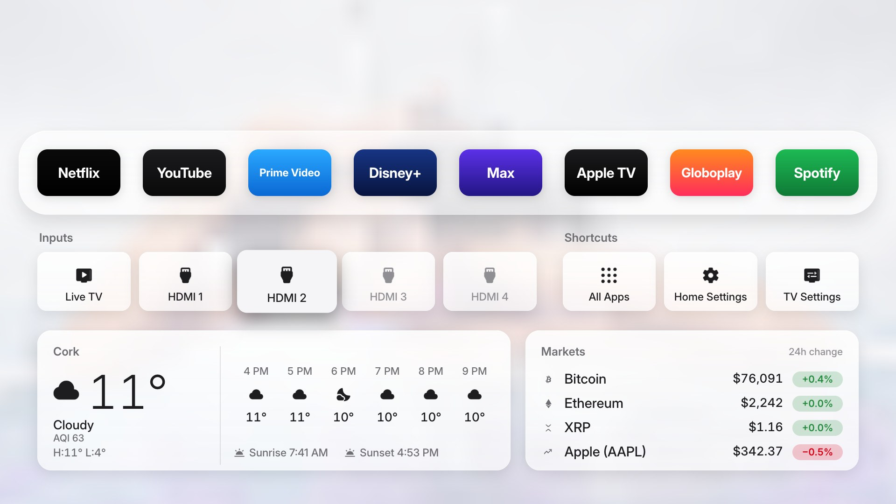
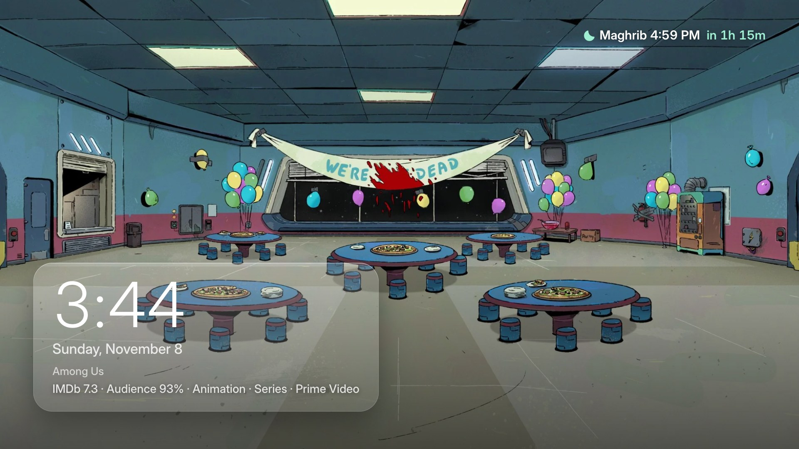
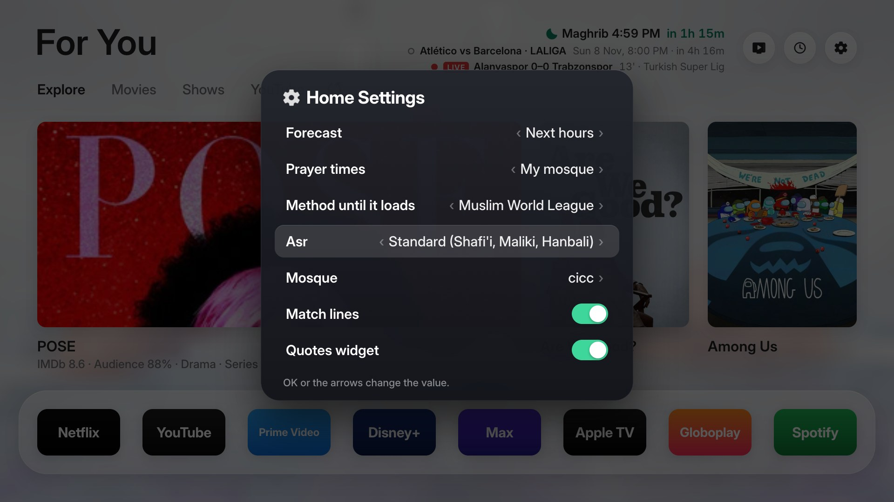
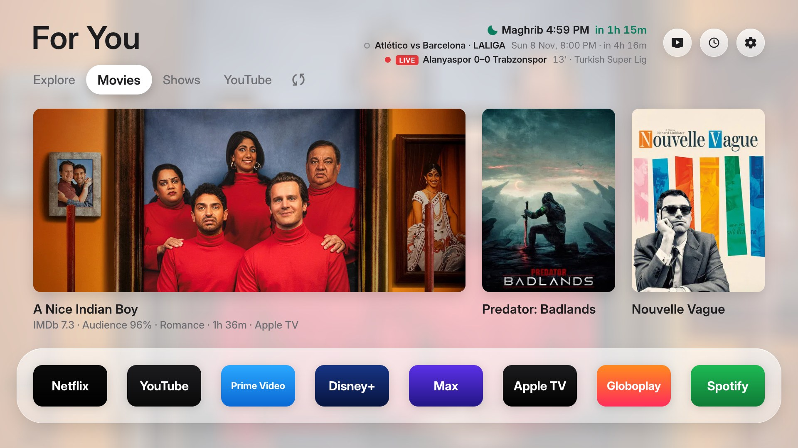

<div align="center">

# Haven TV

**A calm, ad-free home screen for Samsung TVs.**

Your picks with their IMDb and audience scores, your YouTube subscriptions, 4K photos with a quiet clock,<br>
your next prayer, your team's next match, and nothing you didn't ask for.


[Features](#-features) · [Install](#-install-in-10-minutes) · [LG TVs](#-lg-tvs-webos) · [Set it up](#-first-time-setup-on-the-tv) · [Make it yours](#-make-it-yours) · [Build your own copy](#-build-your-own-copy) · [FAQ](#-faq) · [Privacy](#-privacy)

<br>



<sub>Your picks with their scores · the next prayer · your teams' matches, live · your apps</sub>

</div>

<table>
  <tr>
    <td width="50%"><br><sub><b>Clock</b>: 4K photos with the time, date and next prayer</sub></td>
    <td width="50%"><br><sub><b>One press down</b>: inputs, shortcuts, weather and markets</sub></td>
  </tr>
  <tr>
    <td width="50%"><br><sub><b>Screensaver</b>: your picks, their scores and your next prayer</sub></td>
    <td width="50%"><br><sub><b>Home Settings</b>: prayer times your way, or off</sub></td>
  </tr>
  <tr>
    <td width="50%"><br><sub><b>Movies</b>: from your own lists, with IMDb and audience scores</sub></td>
    <td width="50%" valign="middle" align="center"><b>Explore · Movies · Shows · YouTube · ↻</b><br><br><sub>A new set every 30 minutes, or right away with ↻.<br>YouTube shows the newest from your subscriptions.</sub></td>
  </tr>
</table>

---

## ✨ Features

| | |
|---|---|
| 🎬 **Your picks, not ads** | Movies and shows from **your own MDBList lists**: your streaming services, your language, your minimum scores. Each shows its **IMDb rating**, **Rotten Tomatoes audience score**, genre, length and the service it's on. A new set every 30 minutes; ↻ for a new set right away. |
| ▶️ **YouTube tab** | The newest videos from **your subscriptions**, channels you watch and like most first, no Shorts. Sign in once with a code. ↻ pages through. |
| 🕰️ **Clock** | Full-screen **4K photos** (Bing's photo of the day and Unsplash) with one quiet line on top: the time, the date and your next prayer. Dimmer in the evening, like a Frame TV. |
| 🕌 **Prayer times** *(optional)* | The next prayer with its iqama and a countdown: **your mosque's own timetable**, or **calculated for any city** with 12 methods (Umm al-Qura, Egyptian, ISNA, Diyanet, Karachi…). Jumuah on Fridays. Or turn it off completely. |
| ⚽ **Next match** *(optional)* | Your teams' next matches in every competition, in your time with a countdown, or **LIVE** with the score. |
| 📈 **Markets** | The coins and stocks you choose, in the drawer. |
| 🌤️ **Weather** | Now, the next hours or days, rain in the next two hours, UV and air quality. |
| 🌙 **Calm by design** | Light by day, dark after sunset, dimming for a dark room, and a screensaver with your picks and their scores. |

> Haven TV runs as an app on your Samsung or LG TV. The TV's own home screen stays where it is, and uninstalling Haven TV leaves the TV exactly as it was.

---

## 🚀 Install in 10 minutes

You need a **Samsung TV from 2017 or newer** (Tizen 3+) and a **computer on the same Wi-Fi**. **LG TV?** See [LG TVs](#-lg-tvs-webos).

### 1. Turn on Developer Mode on the TV
1. Press **Home** and open **Apps**.
2. Type **1 2 3 4 5** on the remote. No number keys? Press the **123** button for the on-screen number pad, or use the remote in the **SmartThings** app on your phone.
3. Switch **Developer mode** on and type your **computer's IP address** in *Host PC IP*.
   (Mac: System Settings → Wi-Fi → Details. Windows: `ipconfig`.)
4. **Restart the TV**: hold the power button until the Samsung logo appears.

### 2. Install with TizenBrew Installer
1. Download **TizenBrew Installer** for your computer from [its releases](https://github.com/reisxd/TizenBrewInstaller/releases) and run it.
   On a Mac it's a program that runs in Terminal: `chmod +x TizenBrewInstaller-macos-arm64 && ./TizenBrewInstaller-macos-arm64`
2. Open **http://localhost:8091/ui/dist/index.html** in your browser.
3. **Connect to TV** with your TV's IP address (TV: Settings → General → Network → Network Status → IP Settings).
4. Choose install from GitHub and type **`mjoublack-oss/haven-tv`**.
5. TVs from 2023 on ask you to **sign in to your Samsung account** once: that's how the app gets signed for your TV.

Haven TV now appears in **Apps**. Move it to the first place in the home bar so it's one press away.

> **Tip:** TizenBrew Installer stops when the TV drops an idle connection ("Can't connect to the server"). Start it again and reload the page. On a Mac you can keep it running with
> `while true; do ./TizenBrewInstaller-macos-arm64; sleep 2; done`

---

## 📺 LG TVs (webOS)

Haven TV runs on **LG TVs with webOS 3 or newer** (2016 on) as an app, installed through LG's own **Developer Mode**. Nothing on the TV is rooted or changed, and LG's home screen stays where it is. You need a **computer on the same Wi-Fi** (Windows, Mac or Linux) for the install.

### 1. Turn on Developer Mode on the TV
1. On the computer, create a free **LG developer account** at [webostv.developer.lge.com](https://webostv.developer.lge.com) (*Sign in → Create account*).
2. On the TV, open the **LG Content Store** (*Apps*), search for **Developer Mode** and install it.
3. Open **Developer Mode**, sign in with that account, and switch **Dev Mode Status** on. The TV restarts.
4. Open **Developer Mode** again and switch **Key Server** on. Note the **IP address** and the **passphrase** it shows (six letters and numbers, e.g. `A1B2C3`).

### 2. Install Haven TV with webOS Dev Manager
[webOS Dev Manager](https://github.com/webosbrew/dev-manager-desktop) is a free desktop app for exactly this: no command line, no LG SDK.

1. Download **Haven TV for LG** (`HavenTV-webos.ipk`) from the [latest release](https://github.com/mjoublack-oss/haven-tv/releases/latest).
2. Download and open **webOS Dev Manager** from [its releases](https://github.com/webosbrew/dev-manager-desktop/releases/latest) (Windows `.msi`, Mac `.dmg`, Linux `.deb` or `.AppImage`).
3. **Add a device:** enter the TV's IP address and, when asked, the passphrase from the Developer Mode app.
4. Open **Apps → Install** (the ⊕ / upload button), pick `HavenTV-webos.ipk`, and wait for *Installed*.

**Haven TV** now appears in LG's app list.

### 3. Make it one press away
- **While Haven TV is open, hold a number key** on the remote (e.g. **1**) to pin it to that key. From then on, holding that key opens Haven TV from anywhere.
- No number keys (Magic Remote)? Move Haven TV to the front of LG's app list with its **Edit** option, so it's the first app on the home screen.

### 4. Keep Developer Mode alive
LG switches Developer Mode off after **about 40 days** without renewal, and apps installed through it are removed (installing again brings Haven TV back). Either:
- open the **Developer Mode** app on the TV now and then and press **Extend**, or
- let **webOS Dev Manager** do it: its device page shows the time left with a **Renew** button, and it can create a script that renews on a schedule.

### On LG, a few things differ
| | |
|---|---|
| **Apps on the shelf** | webOS 6 and newer ask once, on the TV, whether Haven TV may see your apps: choose *Allow*. |
| **YouTube tab** | Selecting a video opens the YouTube app; it doesn't jump straight into that video. |
| **Home and Back from other apps** | LG's own home screen answers them; use your pinned number key to come back. |

> **Prefer the command line?** `python3 webos/build.py --generic` builds the `.ipk`, and `python3 webos/install.py <TV-IP>` installs it (it asks for the passphrase the first time). `python3 webos/renew.py <TV-IP>` extends Developer Mode.

---

## 📺 First-time setup on the TV

Open **Haven TV** and the gear (top right) for **Home Settings**:

1. **City:** for the weather, the evening look, and calculated prayer times.
2. **MDBList key:** for your picks ([how to get one](#-your-picks-mdblist)).
3. **Prayer times:** *Off*, *Calculated for your city* or *My mosque* ([details](#-prayer-times)).
4. **Shelf:** your apps, in your order.
5. **YouTube tab:** open it once and enter the code it shows at **google.com/device** on your phone.

---

## 🎨 Make it yours

### 🕌 Prayer times
*Home Settings → Prayer times* has three choices:

| Choice | What you get |
|---|---|
| **Off** | No prayer line anywhere: home screen, screensaver and Clock. |
| **Calculated for my city** | Adhan times for the weather's city, anywhere in the world. Pick the method your country uses (below) and the Asr rule (*Standard* or *Hanafi*). |
| **My mosque** | Your mosque's **own adhan and iqama times for the whole year**, read again every few hours, Jumuah included. Your mosque must be on **[themasjidapp.org](https://themasjidapp.org)**: its address ends in a short name (`themasjidapp.org/cicc` → `cicc`). Type that under *Mosque*. |

| Method | Commonly used in |
|---|---|
| Muslim World League | Europe, Far East, much of the world |
| Umm al-Qura, Makkah | Saudi Arabia |
| Egyptian General Authority | Egypt, Africa, Syria, Lebanon |
| University of Islamic Sciences, Karachi | Pakistan, Bangladesh, India, Afghanistan |
| ISNA | USA, Canada |
| Dubai | UAE |
| Kuwait · Qatar | Kuwait · Qatar |
| Diyanet | Turkey |
| Singapore | Singapore, Malaysia, Indonesia |
| Tehran | Iran |
| UOIF | France |

Times are calculated on the TV; nothing about your prayers leaves it, except reading your mosque's public page.

### 🎬 Your picks (MDBList)
1. Create a free account at **[mdblist.com](https://mdblist.com)**.
2. Open **Movies** in the top menu, set your filters (streaming services, language, minimum IMDb rating, minimum *RT Audience*, years, genres to leave out), then **Search**.
3. Expand **Create list**, name it (e.g. *Movies*) and create it. Do the same under **Shows**.
4. Wait until the lists show titles instead of *Waiting* (minutes to a few hours, the first time).
5. **Preferences → API key**: type it on the TV in *Home Settings → MDBList key*.

Every list on your MDBList account feeds the picks. Edit a list's filters on mdblist.com at any time; the TV follows.

### ⚽ Teams, 📈 markets and 🕰️ Clock photos
These come from **`haven.properties`** when you [build your own copy](#-build-your-own-copy):

```properties
teams=83:Barcelona,997:Trabzonspor     # ESPN team ids; leave empty for none
coins=BTC,ETH,XRP                      # Binance, in US dollars
stocks=AAPL,MSFT                       # Yahoo Finance tickers
photo_themes=landscape,mountains,ocean,night sky
photo_seconds=30
```

Find a team's id in its ESPN address: `espn.com/soccer/team/_/id/83/barcelona` → **83**. A few: Barcelona 83, Real Madrid 86, Arsenal 359, Man United 360, Liverpool 364, Man City 382, PSG 160, Bayern 132, Juventus 111, Galatasaray 432, Fenerbahçe 436, Trabzonspor 997, Al Hilal 929, Al Nassr 817.

On the TV, *Home Settings* turns the match lines and each coin or stock on or off.

---

## 🛠️ Build your own copy

The release above is set up for its maintainer (Cork prayer times, Barcelona and Trabzonspor, their YouTube and Unsplash access). To make it fully yours:

1. **Fork** this repository and clone your fork.
2. **Personal settings:** run `python3 tizen/build.py --generic` once. It creates `haven.properties` from [`haven.example.properties`](haven.example.properties). Edit it: prayer times, teams, markets, photos.
3. **YouTube tab** *(optional)*: in [Google Cloud Console](https://console.cloud.google.com), create a project, enable **YouTube Data API v3**, set up the OAuth consent screen (External; scope `youtube.readonly`; publishing status **In production**, so the TV isn't signed out every 7 days), then create an OAuth client of type **TVs and Limited Input devices**. Save it as `youtube.local.json`:
   ```json
   { "clientId": "….apps.googleusercontent.com", "clientSecret": "GOCSPX-…" }
   ```
4. **Clock photos from Unsplash** *(optional)*: create a free app at [unsplash.com/oauth/applications](https://unsplash.com/oauth/applications) and save its Access Key as `unsplash.local.json`:
   ```json
   { "accessKey": "…" }
   ```
   Without it, the Clock uses Bing's daily 4K photo only.
5. **Build:** `python3 tizen/build.py --generic` → `FreeMyTV-tizen.wgt` (Samsung), and `python3 webos/build.py --generic` → `FreeMyTV-webos.ipk` (LG).
6. **Samsung:** publish a release of your fork with the `.wgt` attached, then install from TizenBrew Installer with **`your-name/your-fork`**.
   **LG:** install the `.ipk` with webOS Dev Manager, or `python3 webos/install.py <TV-IP>`.

`haven.properties`, `youtube.local.json` and `unsplash.local.json` are git-ignored: they stay on your computer and only go into the package you build.

> **Prefer to just ask?** Open the folder in [Claude Code](https://claude.com/claude-code) and say *"Set up Haven TV for me: I live in Istanbul, my team is Galatasaray, prayer times by Diyanet."*

---

## ❓ FAQ

<details><summary><b>Can Back or Home from Netflix/YouTube return to Haven TV?</b></summary>

No. On Samsung TVs, when an app closes, Samsung's system shows its own home screen, and other apps can't change that. Keep Haven TV first in the home bar: **Home → OK** takes you back.
</details>

<details><summary><b>Can it show Netflix's Continue Watching?</b></summary>

No. Netflix has had no public API since 2014, and Samsung doesn't let apps see what other apps play. Netflix's own Continue Watching is the first row in the Netflix app.
</details>

<details><summary><b>Why does YouTube show "Google hasn't verified this app"?</b></summary>

Your Google project isn't reviewed by Google (that's for public apps). Choose **Advanced → Go to (your app)**. Access is read-only.
</details>

<details><summary><b>The prayer line says "approx."</b></summary>

*My mosque* is chosen but the mosque's page couldn't be read yet: the times are calculated for your city meanwhile. Check the short name under *Mosque*.
</details>

<details><summary><b>An update didn't install (About still shows the old version)</b></summary>

Uninstall Haven TV from **Apps**, install again, then re-enter the MDBList key and sign in to YouTube again.
</details>

<details><summary><b>TizenBrew Installer says "Can't connect to the server"</b></summary>

It stopped when the TV dropped an idle connection. Start it again and reload the page (see the tip under Install).
</details>

---

## 🔒 Privacy

No accounts of ours, no analytics, no tracking. The TV talks only to the services that bring what you see:

| Service | Why | Only when |
|---|---|---|
| MDBList | your picks and their scores | you've added your key |
| YouTube (Google) | your subscriptions' newest videos, read-only | you've signed in |
| Bing, Unsplash | Clock photos | the Clock is open |
| themasjidapp.org | your mosque's timetable | *My mosque* is chosen |
| ESPN | your teams' matches | you've set teams |
| Binance, Yahoo Finance | Markets | the Markets card is on |
| Open-Meteo | weather, sunrise, sunset, air quality | always (your city's coordinates only) |

Keys and sign-ins stay on the TV.

---

## 🙏 Credits

- Built on **[Free My TV](https://github.com/simbasjungles/free-my-tv)** by simbasjungles (MIT): the home screen, the shelf, the weather and the Samsung app. Its original README is kept as [UPSTREAM-README.md](UPSTREAM-README.md).
- Installs with **[TizenBrew Installer](https://github.com/reisxd/TizenBrewInstaller)** by reisxd.
- Picks and scores: **[MDBList](https://mdblist.com)**. Images by TMDB, not endorsed or certified by TMDB.
- Photos: **Bing** (used as wallpaper) and **[Unsplash](https://unsplash.com)** (photographers credited on screen).
- Prayer timetables: **[themasjidapp.org](https://themasjidapp.org)**. Matches: ESPN. Weather: **[Open-Meteo](https://open-meteo.com)** (CC BY 4.0).
- Not affiliated with Samsung, Google, Netflix or any streaming service.

## 📄 License

MIT, like Free My TV. Fork it, change it, make it yours.
